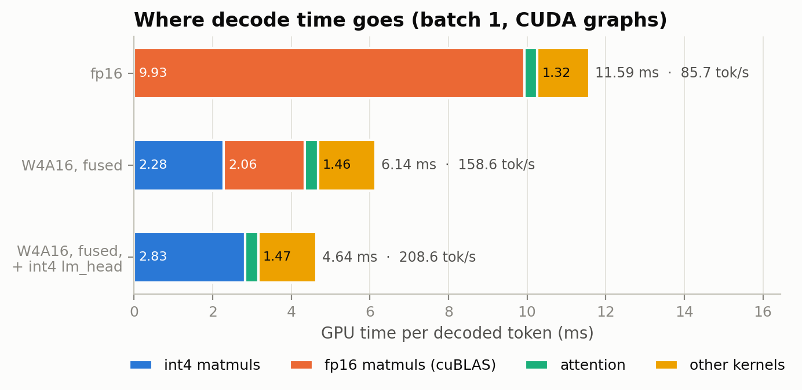
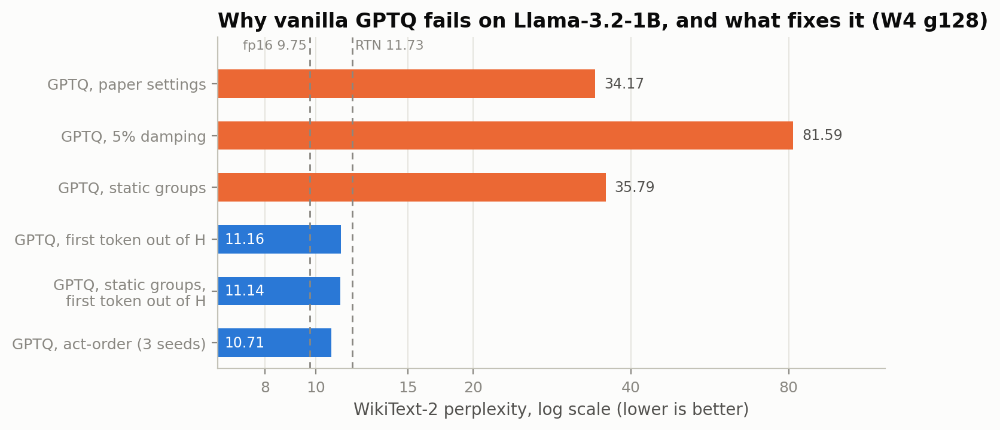
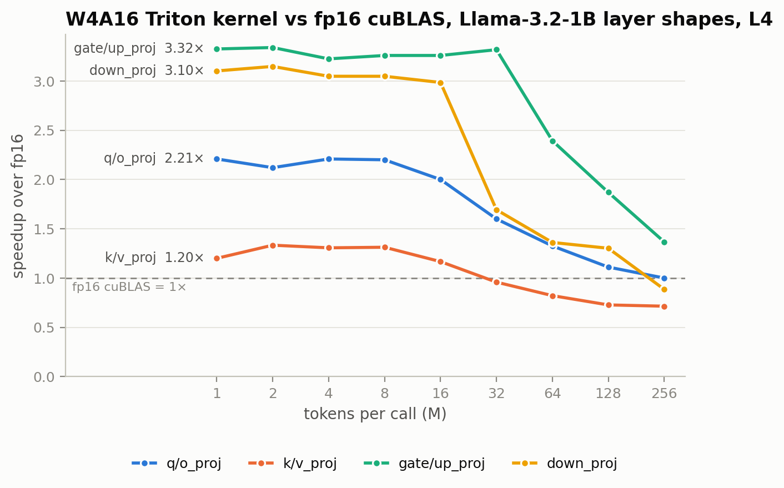
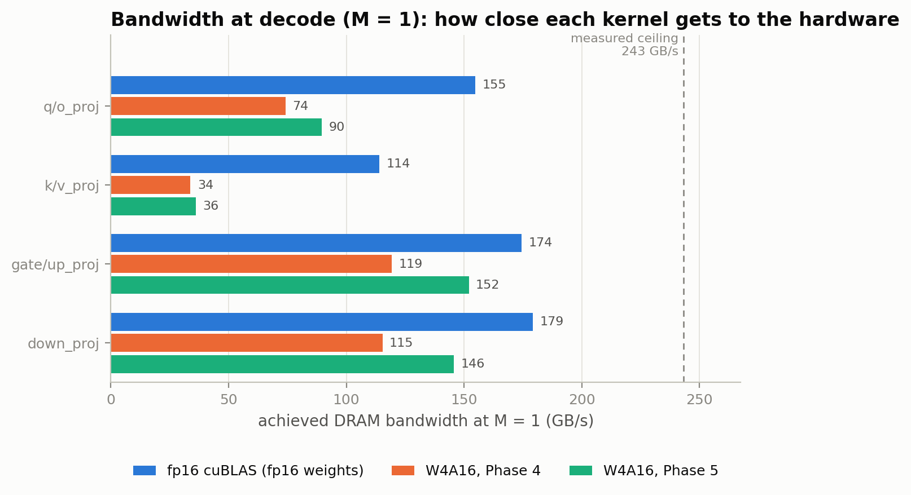

# quantkit: from-scratch INT4 weight quantization with a fused Triton W4A16 kernel

RTN and GPTQ implemented from the papers and checked against the reference library, served through fused
Triton dequant-matmul kernels so the quantized model is actually faster, not just smaller, and measured end to
end against fp16. Everything runs on a single NVIDIA L4 (24 GB) with Llama-3.2-1B.

Most quantization reimplementations stop at fake quantization (quantize, dequantize back to fp16, report
perplexity). That shows accuracy but no speedup. This project closes the loop: packed int4 weights, kernels
that read them directly, and decode throughput, memory and downstream accuracy against fp16.

## Results at a glance

Llama-3.2-1B on one NVIDIA L4. Batch-1 greedy decode with CUDA graphs; zero-shot mean over ARC-easy,
ARC-challenge, HellaSwag, PIQA and WinoGrande (lm-evaluation-harness).

| Model | Weights | WikiText-2 ppl ↓ | 0-shot mean ↑ | Decode tok/s ↑ |
| --- | --- | --- | --- | --- |
| fp16 | 2.47 GB | 9.75 | 59.7 | 85.7 |
| RTN W4 g128 | 1.03 GB | 11.73 | 56.3 | (same kernels as below) |
| GPTQ W4 g128, act-order | 1.03 GB | 10.78 | 58.4 | 158.6 (1.85×) |
| GPTQ W4 g128, act-order, + int4 lm_head | 1.17 GB | 10.94 | 58.7 | **208.6 (2.43×)** |



## Key findings

1. **Vanilla GPTQ breaks on Llama-3.2-1B, and act-order is what fixes it.** With the paper's settings GPTQ is
   three times *worse* than plain rounding (perplexity 34.2 vs 11.7). The cause is the first token of each
   calibration window: it becomes an attention sink with massive activations in a few channels and dominates
   the Hessian. Leaving that one token in 2048 out of the Hessian, or processing columns in act-order, fixes it;
   fixing the group scales does not. [Details](#the-gptq-investigation)
2. **GPTQ's own objective can mislead.** The broken configuration has the *lower* layer-wise reconstruction
   loss on the calibration set (196 vs 217). It fits the calibration data, sink tokens included, and fails on
   new text. Held-out evaluation is essential.
3. **The kernel gets close to the hardware on large layers.** At decode, the W4A16 kernel is 3.1–3.3× faster
   than fp16 cuBLAS on the MLP layers (81–87% of cuBLAS's achieved bandwidth, against an ideal of 3.8×); small
   layers stay launch-bound. [Details](#kernel)
4. **End to end, the non-matmul work sets the ceiling.** Decode is 1.85× faster with int4 linears and 2.43×
   with an int4 lm_head too; the remaining time is mostly small kernels (norms, rotary embeddings, residual
   adds, KV-cache writes), not matmuls. [Details](#end-to-end-decode)
5. **CUDA graphs or nothing.** Launched eagerly from Python, W4A16 decode is 2.2× *slower* than fp16: each
   Triton call costs ~0.3 ms of host overhead. The speedups above need CUDA-graph replay, as serving stacks use.
6. **An int4 lm_head is nearly free in accuracy.** +1.5% perplexity, and no measurable change on downstream
   tasks. GPTQ recovers about 60% of RTN's downstream loss (−1.3 vs −3.4 points). [Details](#downstream-accuracy)

## How it works

### Quantizers

Both methods share one quantizer (`quant/rtn.py`) and one storage format; they differ in how the integer codes
and scales are chosen.

| Method | Idea | Calibration | Implementation |
| --- | --- | --- | --- |
| **RTN** | Round each weight to the nearest grid point, per group | None | Asymmetric/symmetric, per-channel or group-wise, 2–8 bits |
| **GPTQ** (Frantar et al., 2022) | Quantize weight columns one at a time and spread each column's error onto the not-yet-quantized columns, weighted by the inverse Hessian H = 2XXᵀ of the layer's inputs | C4, 128 × 2048 tokens, seed 0 | Cholesky of H⁻¹, blocked lazy updates (block 128), 1% damping, true-sequential layer order, act-order with static groups |

GPTQ details:

- *Verified against the textbook algorithm.* `tests/test_gptq.py` runs a naive Optimal Brain Surgeon loop (one
  column at a time, explicit H⁻¹ with the column removed after each step, no Cholesky, no blocking). The blocked
  Cholesky implementation produces bit-identical codes in float64 for group sizes 32, 128, 256 and per-channel.
- *True sequential.* Within each decoder layer, Linears are quantized in execution order (q/k/v → o → gate/up →
  down); each sub-group's Hessian is collected after the previous sub-groups are quantized, and each layer's
  outputs are recomputed with quantized weights before they become the next layer's inputs.
- *Scales are fp16 during the search,* because the error feedback depends on the exact stored values.
- *Act-order uses static groups:* scales are fixed from the original contiguous columns before reordering, so
  the storage format and kernel need no per-column group index.

### Storage format

The contract between the quantizers and the kernels (`quant/pack.py`):

```
qweight : [K/8, N]  int32   8 nibbles packed along K, little-nibble first
scales  : [K/G, N]  fp16
qzeros  : [K/G, N]  uint8
W[n,k]  = (q[k,n] - qzeros[k/G, n]) * scales[k/G, n]
```

Packing along K with N contiguous means a (BLOCK_K, BLOCK_N) kernel tile loads BLOCK_K / 8 rows of coalesced
int32s. 4 bits plus scales and zeros cost ~4.19 bits per weight, 3.8× fewer bytes than fp16.

### Kernels

At decode a Linear is a matrix-vector product: almost no compute, all the time is spent reading weights. Three
Triton kernels (`kernels/w4a16.py`) read the packed weights and dequantize in registers inside the matmul loop:

- **Tiled** (`_w4a16_gemm`): (M, N) tiles, full K loop, direct fp16 store; BLOCK_M down to 16, so it also covers
  decode in one launch.
- **Split-K** (`_w4a16_splitk`, M ≤ 16): adds a grid dimension over K so narrow layers (k/v_proj has N = 512)
  get enough programs for the L4's 58 SMs; partial sums are added atomically in fp32.
- **GEMV** (`_w4a16_gemv`, M = 1): no tensor cores, no 16-row padding.

Packed weights are unpacked either once per tile (load [BLOCK_K / 8, BLOCK_N] int32s, expand by 8 shifts,
reshape) or once per nibble; neither wins everywhere. Block sizes, split factor, warps and pipeline stages are
autotuned per shape (M bucketed to powers of two above 16), and `path="auto"` times every kernel × unpack variant
on first use for a shape and caches the fastest. Dequantized weights are bit-identical to the reference path;
outputs differ only in summation order (the atomic paths are not bitwise deterministic run to run).

Correctness (`tests/test_kernel.py`): every kernel × unpack variant against an fp32 reference on the exact
dequantized weights, including ragged M and N, extreme codes and zero points, and a one-hot test that each
nibble lands in the right row; on a GPU, the autotuned kernels on all Llama-3.2-1B layer shapes for M = 1…255.
Without a GPU the tests run the real kernel code in Triton's CPU interpreter; deliberately broken nibble shifts,
zero points, group indexing and nibble order all make them fail. Whole-model perplexity through the kernels
reproduces the reference path (11.728 vs 11.728 RTN; 10.781 vs 10.780 GPTQ, fused).

### Model integration

- **Fusion** (`fuse.py`): q/k/v and gate/up concatenated into single matmuls at runtime (fp16 or int4).
- **int4 lm_head** (`model.quantize_lm_head`): Llama-3.2-1B ties lm_head to the input embedding. A decode step
  reads one row of the embedding but all of lm_head, so lm_head is untied and RTN-quantized while the embedding
  stays fp16: stored weights grow by 0.14 GB, bytes read per token fall by ~0.4 GB.
- **Decoding** (`decode.py`): greedy batch-1 generation with a static KV cache, eager or replayed from a CUDA
  graph; matches HF `generate` token for token (tested).

## Detailed results

Evaluation protocol: WikiText-2 test and C4 validation shard, non-overlapping 2048-token windows; zero-shot
lm-evaluation-harness tasks (acc_norm where defined, WinoGrande acc); kernel timings with
`triton.testing.do_bench` (L2 flushed), median of interleaved rounds; every results JSON records GPU, driver,
clocks and library versions.

### Accuracy

Llama-3.2-1B, W4 g128 unless stated. Percentages relative to fp16.

| Method | Bits | Group | WikiText-2 ↓ | C4 ↓ | 0-shot mean ↑ |
| --- | --- | --- | --- | --- | --- |
| fp16 | 16 | – | 9.751 | 14.012 | 59.7 |
| RTN | 4 | per-channel | 18.084 (+85%) | 27.622 (+97%) | |
| RTN | 4 | 128 | 11.728 (+20%) | 17.439 (+24%) | 56.3 |
| **GPTQ, act-order** | 4 | 128 | **10.780 (+11%)**; 3 seeds 10.71 ± 0.11 | 15.320 (+9%) | 58.4 |
| GPTQ, act-order, + int4 lm_head (g128) | 4 | 128 | 10.938 (+12%) | 15.558 (+11%) | 58.7 |
| GPTQ, act-order, + int4 lm_head (g64) | 4 | 128 | 10.888 (+12%) | 15.518 (+11%) | |
| fp16, only lm_head int4 | 16 / 4 | 128 | 9.891 (+1.4%) | 14.224 (+1.5%) | |
| RTN (fake quant) | 3 | 128 | 35.041 (+259%) | 57.175 (+308%) | |
| GPTQ (fake quant) | 3 | 128 | 32.172 | 43.773 | |

The packed RTN checkpoint, saved and reloaded, reproduces the in-memory perplexity exactly (11.728).

### The GPTQ investigation



| GPTQ variant (W4 g128) | WikiText-2 | C4 |
| --- | --- | --- |
| Paper settings (1% damping, natural column order) | 34.171 | 74.037 |
| 5% damping (GPTQModel's default) | 81.593 | 130.603 |
| Static groups, natural order | 35.795 | |
| First calibration token left out of H | 11.155 | |
| First 4 tokens left out of H | 11.099 | |
| Static groups, first token left out of H | 11.145 | |
| **Act-order (static groups)**, 3 calibration seeds | **10.780, 10.763, 10.573** (10.71 ± 0.11) | 15.320 |
| Act-order, first token left out of H | 11.238 | |
| GPTQModel 7.11, paper settings, same calibration windows | 50.863 | 101.697 |

- **The failure is not specific to this implementation:** GPTQModel with the same settings and calibration
  windows also breaks (50.9).
- **The first token is the cause.** It becomes an attention sink with massive activations in a few channels;
  one such token per 2048-token window dominates each Hessian. The most lopsided Hessians are attention `q_proj`
  inputs (diagonal max/median up to ~230, vs under ~75 for MLP inputs).
- **Column order fixes it, group scales don't.** Static scales without reordering still break (35.8);
  act-order recovers 10.71 ± 0.11 over three seeds, −8.7% vs RTN, without dropping any tokens. With act-order,
  dropping the first token makes things *worse* (11.24, about 5 standard deviations of the seed spread): once
  columns are ordered, the sink token carries useful information.
- **GPTQ's objective does not predict quality.** Summed reconstruction loss is lower for the broken run (196)
  than for act-order (217).
- **Unexplained:** raising damping to 5% makes plain GPTQ worse (81.6) rather than pulling it toward RTN.

**Parity with GPTQModel** (matched act-order settings, identical calibration windows): GPTQModel is worse on
every seed, 11.01 ± 0.02 vs 10.71 ± 0.11, a systematic ~3% gap. Ruled out:

- *Numerical noise.* Group scales are identical in every module, and integer codes agree on 75–91% of weights
  with no drift across layers. Code agreement is not a quality measure: re-running quantkit with TF32 matmuls
  flips about as many codes (15% by layer 1) yet moves perplexity by 0.1% (10.768 vs 10.780), because every
  rounding error feeds all later columns of its row.
- *Precision.* GPTQModel works in bf16, quantkit in fp16, but switching either barely moves the result (fp16
  model evaluated in bf16: 9.757 vs 9.751; quantkit GPTQ run fully in bf16: 10.819 vs 10.780; GPTQModel's
  checkpoint evaluated in fp16: 11.031 vs 11.028).

Not tested: how GPTQModel captures and deduplicates layer inputs for the Hessians, and where it applies
damping. Correctness here rests on the exact match with the textbook algorithm, identical group scales, no
drift across layers, and the seed-tested gain over RTN.

### Kernel

Practical DRAM bandwidth of this L4, measured (`scripts/bw_ceiling.py`): **243 GB/s** streaming read (81% of
the 300 GB/s spec), 231 GB/s copy, 232 GB/s for cuBLAS on an 8192 × 8192 fp16 matrix-vector product.



| Layer (N × K) | fp16 cuBLAS µs | W4A16, Phase 4 → 5 µs | Speedup, Phase 4 → 5 | GB/s: W4A16 / fp16 (% of 243) |
| --- | --- | --- | --- | --- |
| q/o_proj 2048 × 2048 | 54.3 | 29.7 → 24.6 | 1.83× → **2.21×** | 89 (37%) / 154 (64%) |
| k/v_proj 512 × 2048 | 18.4 | 16.4 → 15.4 | 1.12× → **1.19×** | 36 (15%) / 114 (47%) |
| gate/up_proj 8192 × 2048 | 192.5 | 73.7 → 57.9 | 2.61× → **3.32×** | 152 (62%) / 174 (72%) |
| down_proj 2048 × 8192 | 187.4 | 76.3 → 60.4 | 2.46× → **3.10×** | 145 (60%) / 179 (74%) |

Speedup over fp16 cuBLAS as M grows:

| Layer | M=1 | 16 | 32 | 64 | 128 | 256 |
| --- | --- | --- | --- | --- | --- | --- |
| q/o_proj | 2.21× | 2.00× | 1.60× | 1.33× | 1.11× | 1.00× |
| k/v_proj | 1.20× | 1.17× | 0.96× | 0.82× | 0.73× | 0.71× |
| gate/up_proj | 3.32× | 3.26× | 3.32× | 2.39× | 1.87× | 1.37× |
| down_proj | 3.10× | 2.98× | 1.69× | 1.36× | 1.30× | 0.89× |

(Measured before the dispatcher also chose the unpack variant; at M = 32 the per-nibble kernel was faster:
1.75× on q/o_proj, 1.15× on k/v_proj, 1.92× on down_proj.) Int4 wins while the matmul is memory-bound and
fades as M grows and it becomes compute-bound; narrow k/v_proj loses from M = 32.



What each tuning step bought (same-session ablation, `results/phase5/bench_l4_v2.json`):

- *Unpacking once per tile* is the main win on large layers: split-K at M = 1 went from 73.7 to 63.5 µs on
  gate/up_proj and 75.8 to 62.5 µs on down_proj; the tiled kernel at M = 64 from 124.9 to 92.2 µs. It is not
  uniformly better: on k/v_proj the tiled kernel got slower (16.4 → 21.5 µs).
- *A tiled kernel with 16-row blocks* (one launch) is the fastest decode kernel for gate/up_proj (58 vs 64 µs).
- *A GEMV kernel for M = 1* wins narrowly on down_proj and k/v_proj.
- *Measured dispatch* replaced a fixed M ≤ 16 rule that picked kernels up to 50% slower than the best.

**Why small layers stay slow** (Nsight Compute, k/v_proj, M = 1): the matmul kernel itself takes 7.0 µs at 30%
of DRAM bandwidth (128 thread blocks on 58 SMs, 17% achieved occupancy, 96 registers per thread); the zero-fill
(1.8 µs) and fp16 cast (2.2 µs) kernels plus launch gaps make up the rest of 15.4 µs. A 0.55 MB weight read
cannot fill the GPU in one call.

The `reference` path (dequantize all of W to fp16, then matmul) is 15–30× *slower* than fp16, so it is used
for accuracy only.

### End-to-end decode

Llama-3.2-1B, GPTQ W4 g128 act-order, 128-token prompt, 256 greedy tokens, static KV cache
(`scripts/bench_decode.py`). Two sessions; fp16 is re-measured in each.

| Config | Weights GB | Peak GB | Prefill ms | Eager tok/s | CUDA-graph tok/s | GPU ms/token | vs fp16 |
| --- | --- | --- | --- | --- | --- | --- | --- |
| fp16 | 2.47 | 2.53 | 22.1 | 49.1 | 85.3 | 11.58 | 1.00× |
| fp16, q/k/v + gate/up fused | 2.47 | 2.63 | 27.3 | 38.1 | 86.2 | 11.46 | 1.01× |
| W4A16 | 1.03 | 1.11 | 41.1 | 22.0 | 154.6 | 6.36 | 1.81× |
| W4A16, fused | 1.03 | 1.21 | 35.5 | 26.9 | 155.5 | 6.13 | 1.82× |
| *second session:* fp16 | 2.47 | 2.53 | 22.6 | 47.2 | 85.7 | 11.59 | 1.00× |
| W4A16, fused | 1.03 | 1.20 | 36.6 | 26.8 | 158.6 | 6.14 | 1.85× |
| **W4A16, fused, + int4 lm_head** | **1.17** | **1.34** | 35.4 | 26.8 | **208.6** | **4.64** | **2.43×** |

GPU time per token: fp16 spends 9.93 ms in cuBLAS matmuls (all linears and lm_head), 0.34 ms in attention and
1.32 ms elsewhere. W4A16 fused: 2.28 ms int4 matmuls, 2.06 ms fp16 lm_head, 0.34 attention, 1.46 other. With an
int4 lm_head: 2.83 ms int4 matmuls (lm_head included), 0.34 attention, 1.47 other.

- *Graph numbers are bandwidth-bound:* graph time per token is within 0.1–0.3 ms of pure GPU kernel time.
- *Inside the model the int4 linears are 3.4× faster than fp16* (7.86 → 2.28 ms per token), moving weights at
  ~223 GB/s; cuBLAS moves fp16 weights at ~247 GB/s in the model, faster than the L2-flushed micro-benchmark.
- *The int4 lm_head* takes ~0.55 ms instead of 2.06 ms (inferred from the breakdown: int4 time rose from 2.28 to
  2.83 ms; ~250 GB/s, as N = 128256 gives plenty of parallel work).
- *The remaining ceiling is the non-matmul work:* 1.47 of 4.64 ms (32%) goes to norms, rotary embeddings,
  residual adds, KV-cache writes and the split-K zero-fill and cast. Operator fusion (e.g. torch.compile) would
  help fp16 and W4A16 alike; the matmul kernel is no longer the bottleneck.
- *Fusing q/k/v and gate/up barely matters end to end* (+0.6% with graphs): the small layers it fixes were a
  small share of total time.
- *Eager mode:* about 9 ms of host overhead per token for fp16 and 31–39 ms for W4A16, roughly 0.3 ms per Triton
  call (launcher, autotuner lookup, dispatch, output allocation). Eager prefill is slower for the same reason.
  CUDA-graph and eager decoding produce identical tokens.

### Downstream accuracy

lm-evaluation-harness 0.4, zero-shot, full test sets; ± is lm-eval's standard error; quantized models run
through the Triton kernels (`scripts/eval_tasks.py`).

| Model | ARC-e | ARC-c | HellaSwag | PIQA | WinoGrande | Mean | Δ vs fp16 |
| --- | --- | --- | --- | --- | --- | --- | --- |
| fp16 | 62.0 ± 1.0 | 36.7 ± 1.4 | 64.2 ± 0.5 | 74.8 ± 1.0 | 60.7 ± 1.4 | 59.7 | – |
| RTN W4 g128 | 55.6 ± 1.0 | 32.3 ± 1.4 | 60.3 ± 0.5 | 72.3 ± 1.0 | 60.9 ± 1.4 | 56.3 | −3.4 |
| GPTQ W4 g128, act-order | 60.1 ± 1.0 | 34.8 ± 1.4 | 62.6 ± 0.5 | 74.0 ± 1.0 | 60.4 ± 1.4 | 58.4 | −1.3 |
| GPTQ + int4 lm_head | 59.8 ± 1.0 | 34.8 ± 1.4 | 62.8 ± 0.5 | 74.7 ± 1.0 | 61.2 ± 1.4 | 58.7 | −1.0 |

- RTN's loss is clear on every task but WinoGrande (ARC-e −6.4, HellaSwag −3.9); GPTQ recovers ~60% of it,
  consistent with recovering about half the perplexity loss.
- The int4 lm_head shows no measurable downstream cost: every difference from GPTQ alone is within one
  standard error (HellaSwag, the tightest at ±0.5, moves +0.2). Perplexity (+1.5%) is the more sensitive probe.
- WinoGrande separates none of the models (60.4–61.2 ± 1.4).
- Standard errors are per model; the models answer the same questions, so paired differences are less
  uncertain than these intervals suggest. One run per model.

## Reproduce

```bash
pip install -e '.[dev]'           # add '.[eval]' for lm-evaluation-harness
python -m pytest -q               # CPU tests (kernels run in Triton's interpreter)
python -m pytest -q -m gpu        # GPU tests
```

On Colab: select an **L4** runtime, add `HF_TOKEN` to Colab Secrets (Llama-3.2 is gated; accept the license on
Hugging Face first), and run `notebooks/colab_runner.ipynb`, which only clones, installs and calls scripts.
Checkpoints and results go to Google Drive; the Hugging Face cache stays on local disk (reading a freshly
written multi-GB `model.safetensors` back through the Drive mount corrupted it).

```bash
# Accuracy
python scripts/quantize_eval.py --method fp16
python scripts/quantize_eval.py --method rtn --group-size 128 --save ckpt/rtn-g128
python scripts/quantize_eval.py --method gptq --act-order --save ckpt/gptq-ao-g128   # C4, 128 x 2048, seed 0
python scripts/quantize_eval.py --method gptq                                        # paper settings (breaks)
python scripts/quantize_eval.py --method gptq --skip-first-tokens 1                  # attention-sink test
python scripts/inspect_gptq.py results/phase2_diag2/*.json                           # per-module loss, Hessians
python scripts/reference_gptqmodel.py --act-order --out ckpt/ref-gptqmodel-ao       # GPTQModel parity run
python scripts/compare_checkpoints.py ckpt/gptq-ao-g128 ckpt/ref-gptqmodel-ao        # module-by-module diff

# Kernels
python scripts/bw_ceiling.py                                                         # practical bandwidth
python scripts/bench_kernel.py                                                       # vs cuBLAS, M = 1..256
ncu --profile-from-start off python scripts/profile_kernel.py --shape gate/up_proj --M 1

# End to end
python scripts/quantize_eval.py --load ckpt/gptq-ao-g128 --backend triton --fuse     # fast path, accuracy
python scripts/quantize_eval.py --load ckpt/gptq-ao-g128 --quantize-lm-head --backend triton
python scripts/bench_decode.py --configs fp16 w4+fuse:ckpt/gptq-ao-g128 w4+lmh+fuse:ckpt/gptq-ao-g128
python scripts/eval_tasks.py --configs fp16 w4:ckpt/rtn-g128 w4:ckpt/gptq-ao-g128 w4+lmh:ckpt/gptq-ao-g128

# Figures
python scripts/make_plots.py --results results --out results/plots
```

Every run writes a JSON to `results/` with its settings, metrics and environment. The figures regenerate from
those JSONs with the last command; the tables above quote them.

## Repository layout

| Path | What it holds |
| --- | --- |
| `quantkit/quant/` | `pack.py` (int4 format), `rtn.py` (shared quantizer), `qlinear.py` (drop-in Linear, reference and Triton backends), `gptq.py` (Hessian and blocked GPTQ for one matrix) |
| `quantkit/calib/` | calibration sampling (C4, WikiText-2 train) and layer-0 input capture |
| `quantkit/gptq_model.py` | layer-by-layer, true-sequential GPTQ over a HF decoder |
| `quantkit/kernels/w4a16.py` | tiled, split-K and GEMV Triton kernels; autotuning; measured dispatch |
| `quantkit/model.py` | apply RTN, quantize lm_head, save/load packed checkpoints |
| `quantkit/fuse.py`, `decode.py`, `runtime.py` | projection fusion; static-cache decoder (eager or CUDA graph); config strings for benchmarks |
| `quantkit/eval/`, `env.py` | perplexity; environment capture for every result |
| `scripts/` | quantize/evaluate, GPTQ diagnostics and parity, kernel and decode benchmarks, lm-eval tasks, figures |
| `tests/` | CPU tests (incl. kernels in Triton's interpreter) and GPU tests (`-m gpu`) |
| `notebooks/colab_runner.ipynb` | Colab runner; no logic in cells |
| `results/` | results JSONs and figures |

## Limitations and open items

- **One GPU, one model.** All speed numbers are from an L4, whose modest bandwidth (~243 GB/s) makes W4A16 decode
  gains large; on A100 or H100 the relative gain should shrink. Llama-3.2-1B only; the planned 3B scale check
  was not run.
- **The speedup needs CUDA graphs.** Eager decode with these kernels is slower than fp16 (Python launch cost per
  Triton call). Launching through a cached compiled kernel handle would fix eager mode; not done.
- **GPTQModel parity not reached.** A systematic ~3% perplexity gap (ours lower), with noise and precision ruled
  out; cause unknown.
- **Unexplained:** 5% damping makes plain GPTQ worse.
- **fp16 baseline not cited.** 9.751 matches commonly reported values, but no source with an identical protocol
  has been cited.
- **Not done:** AWQ; ablations over group size (beyond per-channel vs 128 and the lm_head g64 run), calibration
  size and domain, and per-layer sensitivity; activation quantization; on-device export.
- **Statistics.** GPTQ act-order has three calibration seeds; other configurations one. Downstream tasks: one
  run per model.
- **Shared, throttling hardware.** Colab GPUs sit on shared hosts and clocks cannot be locked; kernel timings are
  medians of interleaved rounds, and timings move in ~1 µs steps, so sub-2 µs differences on small layers are
  noise. Nsight Compute locks the L4 to its base clock by default, so it is used for percent-of-peak metrics only.
- **Perplexity is protocol-dependent.** Window length, overlap and split change the numbers.

## Status

| Phase | Outcome |
| --- | --- |
| 1 · Harness + RTN | ✅ lossless int4 packing and save/load; RTN baseline |
| 2 · GPTQ | ✅ exact match with the textbook algorithm; vanilla failure traced to attention sinks; act-order fix (3 seeds); ✗ GPTQModel parity (3% gap) |
| 3 · AWQ | not started |
| 4 · Triton kernel | ✅ correct on all shapes; faster than cuBLAS at decode on every layer |
| 5 · Kernel tuning | ✅ 81–87% of cuBLAS bandwidth on large layers; ✗ small-layer floor |
| 6 · End to end | ✅ 1.85× (2.43× with int4 lm_head) decode with CUDA graphs; downstream tasks; ✗ eager mode |
| 7 · Write-up | ✅ this page and the figures |

Next: AWQ; operator fusion for the non-matmul kernels; a low-overhead launch path for eager mode; an on-device
backend (W8A8 with static activation scales, ExecuTorch + XNNPACK) reusing the same core.

## License

MIT.
